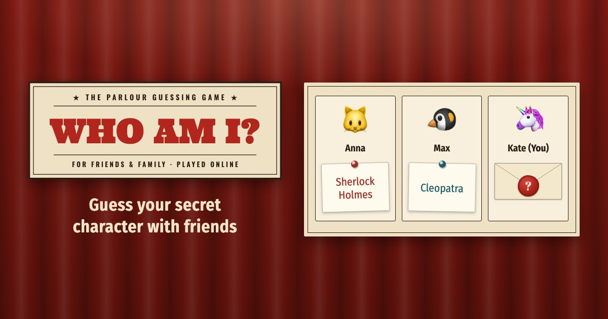

# Who am I?



The classic guessing party game, played remotely. Every player gets a secret character chosen by the others and asks yes/no questions to find out who they are. Create a room, send the link to friends and family, play — no accounts, nothing to install.

**Play:** https://whoami-game.onrender.com/

## Features

- Rooms with a 6-character code and a link to share (the Share button opens the phone's share sheet)
- Players assign characters to each other; your own stays hidden until you reveal it
- Emoji avatars or your own photo
- English and Russian
- Reconnects after a lost connection
- Installable as an app (PWA); needs an internet connection

## How to Run

Running the game needs Node.js 18 or newer; the development tools (ESLint) need Node.js 20.19+, 22.13+ or 24+.

```bash
npm install
npm start          # http://localhost:3000
```

## Development

```bash
npx playwright install chromium   # once: the browser for the browser tests
npm test           # all checks: ESLint, Jest, then the game in a real browser (Playwright)
npm run lint       # ESLint only
npm run test:e2e   # browser tests only: a phone and a desktop, several players per room
```

- `CLAUDE.md` — architecture, rules, git flow
- `docs/testing.md` — how the tests are organized and written
- `docs/release.md` — releases, hotfixes and the check of production
- `docs/publishing.md` — link previews, robots, where the site's address is written

The documents in `docs/` are written in Russian.

## Technologies

- Server: Node.js, Express, Socket.IO
- Browser: plain JavaScript and Bootstrap 5 — no framework, no build step
- Checks: ESLint, Jest and supertest, Playwright and axe-core
- Hosting: Render

## Contributing

This is a personal project, open to read and to learn from. Bug reports and ideas are welcome as [issues](https://github.com/mikhail-e/whoami-game/issues); I don't plan to accept pull requests.

To report a security problem, see [SECURITY.md](SECURITY.md) — please don't open a public issue for it.

## License

The code is released under the [MIT License](LICENSE).

The license does not cover the game's brand: the "WHO AM I?" sign (`svg.brand-sign` in the pages), the wax-seal app icon (`public/icons/`, `public/favicon.ico`, `scripts/icon.html`) and the link preview picture (`public/img/og-image-2.jpg`, `scripts/og-image.html`). All rights to them are reserved (except the emoji avatars in the picture, drawn by the system's emoji font); a copy of the game must replace them with its own.

Third-party files keep their own licenses: the fonts in `public/fonts/` (SIL Open Font License; Ultra — Apache License 2.0; the license files are next to the fonts) and Bootstrap in `public/vendor/bootstrap/` (MIT). The cup in the Buy Me a Coffee button (`public/img/bmc-cup.svg`) is Buy Me a Coffee's logo.

## Credits

Developed with [Claude Code](https://claude.ai/claude-code).
